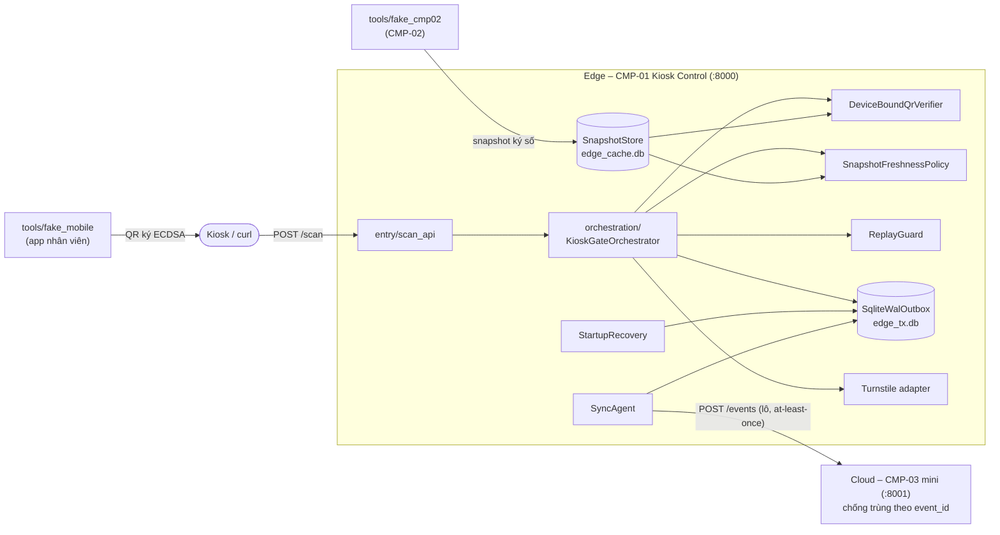

# tmc-attendance-system

[](https://github.com/thanhtuan235/tmc-attendance-system/actions/workflows/ci.yml)

**Task 2 – Code Implementation** của Bài tập lớn Kiến trúc phần mềm (HK261): hiện thực module chính
**CMP-01 Kiosk Control Service** (Edge) của hệ thống **TMC QR Attendance & Access Control**,
cùng **CMP-03 mini** (Cloud) làm đầu nhận để kiểm chứng đồng bộ.

Code bám theo thiết kế ở báo cáo M2: Module view, C&C view, Implementation view (P8-02),
các ADR vấn đề 1 (kết nối / không mất bản ghi) và vấn đề 2 (bảo mật QR), và nguyên tắc SOLID.

---

## Mục lục

1. [Vì sao chọn CMP-01](#1-vì-sao-chọn-cmp-01)
2. [Kiến trúc trong code](#2-kiến-trúc-trong-code)
3. [Cài đặt](#3-cài-đặt)
4. [Chạy demo 6 kịch bản](#4-chạy-demo-6-kịch-bản)
5. [Chạy tay và API](#5-chạy-tay-và-api)
6. [Kiểm thử và CI](#6-kiểm-thử-và-ci)
7. [Truy vết thiết kế → code](#7-truy-vết-thiết-kế--code)
8. [SOLID trong code](#8-solid-trong-code)
9. [Cấu hình](#9-cấu-hình)
10. [Giới hạn và phần thay bằng stub](#10-giới-hạn-và-phần-thay-bằng-stub)
11. [Quy trình Git và phân công](#11-quy-trình-git-và-phân-công)

---

## 1. Vì sao chọn CMP-01

CMP-01 là thành phần **trên đường nóng** của hệ thống: mọi lượt quét QR ở cổng nhà máy đi qua nó.
Nó gánh hai đặc tính ưu tiên cao nhất và trực tiếp hiện thực cả hai vấn đề kiến trúc của M2:

| Đặc tính / vấn đề | CMP-01 xử lý thế nào |
|---|---|
| **Performance** – quét → mở cổng P95 ≤ 2 s (NFR-01) | Xác minh QR **ngay tại Edge** bằng chữ ký ECDSA và snapshot khóa cục bộ, không gọi Cloud |
| **Availability / Reliability** – không mất bản ghi (ADR vấn đề 1) | Outbox SQLite WAL ghi bền trước khi mở cổng; Sync Agent đẩy lên Cloud at-least-once; Recovery sau sự cố |
| **Security** – QR không bị chụp lại, giả mạo (ADR vấn đề 2) | QR ký bởi khóa gắn thiết bị (did, iat, seq); ReplayGuard; danh sách thu hồi trong snapshot ký số |

## 2. Kiến trúc trong code



Mỗi component tách thành 4 package đúng Implementation view:

```
edge/cmp01_kiosk_control/
├── entry/            # Scan API (FastAPI) – chỉ chuyển HTTP <-> DTO
├── orchestration/    # KioskGateOrchestrator, StartupRecovery, SyncAgent – chỉ import ports/
├── ports/            # Interface (ABC) + DTO bất biến – không có logic, không import adapters
├── adapters/         # Verifier, ReplayGuard, SnapshotStore, Outbox, Turnstile, HttpCloudClient
├── snapshot_acceptance_service.py, snapshot_freshness_policy.py
├── config.py         # Tham số (Bảng 3.5), ghi đè bằng biến môi trường TMC_*
└── main.py           # Composition root – nơi DUY NHẤT tạo lớp cụ thể
cloud/cmp03_attendance_mini/   # POST /events idempotent, GET /events/count
packages/contracts/            # Published Language dùng chung Edge ↔ Cloud
tools/                         # fake_mobile.py, fake_cmp02.py (giả lập app và CMP-02)
scripts/                       # demo.ps1, demo.sh
tests/unit/  tests/e2e/
docs/contracts/cmp03_events.md # Hợp đồng API Edge → CMP-03
```

**Luồng một lượt quét** (`KioskGateOrchestrator`, theo Hình 3.1 / ADR-013):

1. Giải mã QR → `MALFORMED`
2. Đã có `event_id` trong outbox → trả lại kết quả cũ, **không gửi lệnh mở lần hai** (idempotent)
3. Chọn verifier theo trường `v` rồi xác minh chữ ký, cửa sổ `iat`, thiết bị → `BAD_SIGNATURE`, `QR_EXPIRED`, `UNKNOWN_DEVICE`, `DEVICE_REVOKED`…
4. Độ tươi snapshot → `STALE_SNAPSHOT` (chỉ chặn chiều **IN**; chiều **OUT** cho qua và gắn `needs_review`)
5. Chống dùng lại theo `(did, seq)` → `REPLAY`
6. Chấp nhận: ghi outbox `RECEIVED` → ghi dấu mốc `command_sent` → mở cổng → `OPENED` / `UNCONFIRMED` / `FAILED`

## 3. Cài đặt

Yêu cầu Python ≥ 3.11.

```bash
git clone https://github.com/thanhtuan235/tmc-attendance-system.git
cd tmc-attendance-system
python -m venv .venv
source .venv/bin/activate              # Windows: .\.venv\Scripts\Activate.ps1
pip install -e ".[dev]"
pytest -q                              # ~175 test (unit + e2e)
```

## 4. Chạy demo 6 kịch bản

Script tự xóa dữ liệu cũ, cấp khóa thiết bị, phát snapshot, **tự bật / tắt / khởi động lại** Cloud và Edge,
rồi tự kiểm tra kết quả (17 điểm kiểm). Cổng 8000 và 8001 phải đang trống.

```powershell
# Windows
Set-ExecutionPolicy -Scope Process RemoteSigned
.\scripts\demo.ps1              # dừng chờ Enter sau mỗi kịch bản (thuyết trình)
.\scripts\demo.ps1 -NoPause     # chạy liền
```

```bash
# Linux / macOS
bash scripts/demo.sh            # hoặc: bash scripts/demo.sh --no-pause
```

| KB | Tình huống | Kết quả mong đợi |
|---|---|---|
| 1 | QR hợp lệ | `ACCEPTED` / `OPENED`; CMP-03 nhận bản ghi |
| 2 | Chụp màn hình QR đem quét ở cổng khác; QR sửa chữ ký | `REJECTED` / `REPLAY`; `REJECTED` / `BAD_SIGNATURE` |
| 3 | Thiết bị bị thu hồi (snapshot mới) | `REJECTED` / `DEVICE_REVOKED`; thiết bị khác vẫn qua |
| 4 | Mất kết nối Cloud | Cổng vẫn mở; `pending_sync` tăng; có mạng lại → đồng bộ đủ, không trùng |
| 5 | Cổng xoay không phản hồi; Edge sập rồi khởi động lại | `UNCONFIRMED`; sau khởi động QR cũ bị `REPLAY`, QR mới qua |
| 6 | Snapshot cũ hơn 4 giờ | IN: `STALE_SNAPSHOT`; OUT: `OPENED` + `needs_review = true` |

Log server nằm ở `demo-logs/`.

## 5. Chạy tay và API

```bash
# Chuẩn bị khóa và snapshot (mỗi lần phát snapshot mới phải tăng --version)
python -m tools.fake_mobile --did device_001 --export-public-key
python -m tools.fake_cmp02 --device device_001 emp_001 --version 1

# Cửa sổ 1 – Cloud
uvicorn cloud.cmp03_attendance_mini.main:app --port 8001
# Cửa sổ 2 – Edge
uvicorn edge.cmp01_kiosk_control.main:build_app --factory --port 8000

# Sinh QR rồi gọi /scan (hoặc dùng Swagger UI tại http://localhost:8000/docs)
python -m tools.fake_mobile --did device_001
```

| Dịch vụ | Endpoint | Mô tả |
|---|---|---|
| Edge | `POST /scan` | `{station_id, gate_id, direction: IN/OUT, qr}` → `{status, reason_code, event_id, tx_status, needs_review, replayed_result}` |
| Edge | `GET /health` | Kiểm tra sống |
| Edge | `GET /status` | `pending_sync`, `cloud_consecutive_failures`, kết quả Recovery |
| Edge | `POST /admin/snapshot/reload`, `GET /admin/snapshot` | Nạp lại `snapshot.json`, xem snapshot hiện tại |
| Edge | `PUT /admin/turnstile-mode` | `{mode: OK / TIMEOUT / ERROR}` cho cổng giả |
| Cloud | `POST /events`, `GET /events/count` | Nhận lô sự kiện idempotent ([hợp đồng](docs/contracts/cmp03_events.md)) |

Tùy chọn của công cụ giả lập: `fake_mobile --resend | --tamper-sig | --iat <unix> | --seq <n>`;
`fake_cmp02 --revoke-device <did> | --revoke-employee <ref> | --issued-at <ISO UTC>`.

## 6. Kiểm thử và CI

| Loại | Vị trí | Nội dung |
|---|---|---|
| Unit | `tests/unit/` | Từng adapter / lớp điều phối với stub cho mọi port (`dev_stubs.py`); hợp đồng port (`test_ports_contract.py`) |
| E2E | `tests/e2e/test_six_scenarios.py` | Bật **uvicorn thật** cho Edge + Cloud trong thư mục tạm, chạy đủ KB1–KB6 kể cả tắt Cloud và tắt cứng Edge |
| E2E | `tests/e2e/test_t3_snapshot_scenarios.py` | Luồng snapshot CMP-02 → Edge (KB3, KB6) |
| Demo | `scripts/demo.sh --no-pause` | 17 điểm kiểm |

GitHub Actions (`.github/workflows/ci.yml`) chạy trên mọi PR và push vào `dev` / `main`:
**Unit tests → E2E 6 kịch bản → Demo script**; khi lỗi, tải `demo-logs/` lên làm artifact.

```bash
pytest -q tests/unit        # nhanh
pytest -q tests/e2e         # ~15–20 s
```

## 7. Truy vết thiết kế → code

| # | Thành phần CMP-01 (M2) | File | Quyết định thiết kế | Test |
|---|---|---|---|---|
| 1 | Scan API | `entry/scan_api.py` | IGateScan giữ nguyên từ M1 | `test_kiosk_gate_orchestrator.py`, e2e |
| 2 | KioskGateOrchestrator | `orchestration/kiosk_gate_orchestrator.py` | Thứ tự xử lý Hình 3.1, ADR-013 | `test_kiosk_gate_orchestrator.py` |
| 3 | QR verifier (Strategy theo `v`) | `adapters/device_bound_qr_verifier.py`, `adapters/qr_verifier_selector.py` | QR gắn thiết bị `{v, did, iat, seq, sig}` – ADR-012, ADR vấn đề 2 | `test_device_bound_qr_verifier.py`, `test_qr_verifier.py` |
| 4 | ReplayGuard + sàn replay | `adapters/replay_guard.py` | Chống replay theo `(did, seq)` – ADR-013 (thay cache jti của ADR-003) | `test_replay_guard.py` |
| 5 | Snapshot khóa / thu hồi | `adapters/snapshot_store.py`, `snapshot_acceptance_service.py`, `snapshot_freshness_policy.py` | Snapshot ký số, không nhận version cũ hơn; độ tươi theo Bảng 3.4, D-02 | `test_snapshot_*.py`, e2e T3 |
| 6 | Outbox giao dịch | `adapters/sqlite_outbox.py` | SQLite WAL + `synchronous=FULL`, dấu mốc lệnh mở – ADR-010, Δ-C1.6 | `test_outbox.py` |
| 7 | Turnstile gateway + Factory | `adapters/*turnstile*.py` | Adapter theo loại thiết bị, No Blind Retry – ADR-008 | `test_turnstile.py` |
| 8 | Recovery khi khởi động | `orchestration/recovery.py` | `RECEIVED` + đã gửi lệnh → `UNCONFIRMED`, chưa gửi → `FAILED`; đặt sàn replay – ADR-010 | `test_recovery.py`, e2e KB5 |
| 9 | Sync Agent + HttpCloudClient | `orchestration/sync_agent.py`, `adapters/http_cloud_client.py` | At-least-once, backoff có trần – ADR vấn đề 1 | `test_sync_agent.py`, e2e KB4 |
| 10 | CMP-03 mini | `cloud/cmp03_attendance_mini/main.py` | Idempotent theo `event_id`; hợp đồng `packages/contracts` (Δ-Q2.11) | `test_cmp03_attendance_mini.py` |

## 8. SOLID trong code

| Nguyên tắc | Ở đâu trong code |
|---|---|
| **SRP** | Mỗi lớp một lý do thay đổi: `scan_api` chỉ chuyển HTTP ↔ DTO; `KioskGateOrchestrator` chỉ điều phối; chỉ `SqliteWalOutbox` được ghi `edge_tx.db`; `SnapshotFreshnessPolicy` là nơi duy nhất quyết định độ tươi |
| **OCP** | Orchestrator chọn verifier theo trường `v` của QR (`{v.version: v for v in verifiers}`): thêm loại QR mới chỉ cần thêm lớp cài `IQrVerifier` và truyền vào ở `main.py`. Thêm loại cổng chỉ cần thêm adapter vào `TurnstileGatewayFactoryImpl`. Không sửa orchestrator |
| **LSP** | `FakeTurnstileAdapter`, `TcpIpTurnstileAdapter`, `DryContactTurnstileAdapter` thay thế được cho nhau: cùng trả `GateAck`, không ném ngoại lệ, không khẳng định `FAILED` khi chưa chắc. DTO là `frozen dataclass` nên kết quả bất biến |
| **ISP** | Port nhỏ, tách theo vai trò: `IQrVerifier`, `IReplayGuard`, `ISnapshotStore` / `ISnapshotFreshnessPolicy`, `IOutboxRepository`, `ITurnstileGateway`, `ICloudEventClient`, `IClock` |
| **DIP** | `orchestration/` chỉ import `ports/`; lớp cụ thể chỉ được tạo trong `main.py` (composition root). Unit test thay toàn bộ adapter bằng `dev_stubs.py` mà không sửa orchestrator |

## 9. Cấu hình

Mặc định ở `edge/cmp01_kiosk_control/config.py`, ghi đè bằng biến môi trường `TMC_<TÊN_TRƯỜNG_IN_HOA>`.

| Biến | Mặc định | Ý nghĩa |
|---|---|---|
| `TMC_QR_WINDOW_PAST_SEC` / `TMC_QR_WINDOW_FUTURE_SEC` | 30 / 5 | Cửa sổ hợp lệ của `iat` |
| `TMC_CLOCK_MAX_SKEW_SEC` | 5 | Lệch đồng hồ tối đa |
| `TMC_SNAPSHOT_FRESH_MIN` / `TMC_SNAPSHOT_STALE_WARN_MIN` / `TMC_SNAPSHOT_ENTRY_MAX_HOURS` | 5 / 15 / 4 | Ngưỡng độ tươi snapshot |
| `TMC_NFR01_BUDGET_MS` | 2000 | Ngân sách quét → mở cổng |
| `TMC_SYNC_INTERVAL_SEC` / `TMC_SYNC_BATCH_SIZE` | 3 / 100 | Chu kỳ (giây, số nguyên) và kích thước lô đồng bộ |
| `TMC_CLOUD_EVENTS_URL` | `http://127.0.0.1:8001/events` | Địa chỉ CMP-03 |
| `TMC_RUNTIME_DIR` / `TMC_SNAPSHOT_FILE` | `runtime-files` / `snapshot.json` | Nơi lưu db, khóa ghim, snapshot |
| `TMC_TURNSTILE_TYPE` / `TMC_TURNSTILE_MODE` | `FAKE` / `OK` | Loại cổng và chế độ cổng giả |

## 10. Giới hạn và phần thay bằng stub

Task 2 hiện thực **một module chính** theo đề; các phần sau được giả lập hoặc để ngoài phạm vi:

| Trong thiết kế M2 | Trong code Task 2 |
|---|---|
| App mobile nhân viên | `tools/fake_mobile.py` (sinh QR ký ECDSA, lưu khóa ở `tools/devices/`) |
| CMP-02 User & Identity phát snapshot | `tools/fake_cmp02.py` (ký snapshot, ghim khóa gốc) |
| CMP-03 Attendance Event Service đầy đủ | CMP-03 mini: chỉ nhận và đếm sự kiện |
| Thiết bị cổng xoay thật (TCP/IP, dry contact) | `FakeTurnstileAdapter`; hai adapter thật chỉ là khung giữ hợp đồng |
| `GuardStationController` – mở cổng thủ công của bảo vệ | Chưa hiện thực |
| Portal token, RBAC, chính sách trạm (`POLICY_DENIED`) | `PortalTokenVerifier` là khung; chính sách trạm luôn cho qua |
| Redis, Primary/Standby (Keepalived VIP), chrony | ReplayGuard trong bộ nhớ + sàn replay khi khởi động; chạy một node; dùng đồng hồ hệ thống |
| CMP-06 cấu hình tập trung | Biến môi trường `TMC_*` |

## 11. Quy trình Git và phân công

`main` (bản nộp, có tag) ← `dev` (tích hợp) ← `feature/<MãCV>-<mô-tả>`.
Mọi thay đổi qua Pull Request vào `dev`, cần CI xanh và ít nhất 1 người duyệt.

| Nhóm việc | Phạm vi |
|---|---|
| T1 | Khung repo, CI, ports/DTO, orchestrator, Scan API, tích hợp `main.py`, e2e, README |
| T2 | `fake_mobile`, verifier QR, ReplayGuard, script demo |
| T3 | Snapshot (store, chấp nhận, độ tươi), `fake_cmp02`, CMP-03 mini |
| T4 | Outbox SQLite WAL, Turnstile + Factory, Recovery, Sync Agent |
